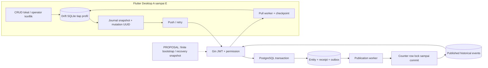

# ADR-0001 — Identitas, lifecycle dan download sinkronisasi multi-device

Tanggal: 30 Oktober 2026. Status: **PROPOSED — untuk review pembimbing**.
Baseline kode: 6a161f5, branch feature/pemohon-cloud-sync. Ini keputusan desain,
bukan aktivasi fitur. Tidak ada perubahan schema/runtime, query database, migrasi,
clone, atau provisioning notarisdev dalam checkpoint ADR ini.

## 1. Keputusan inti dan batas bukti

Pertahankan local PK untuk relasi SQLite; gunakan UUID untuk identitas cloud dan
server integer PK untuk relasi PostgreSQL. Timestamp bukan identitas, versi konflik,
ataupun checkpoint pull. Pending ditentukan dirty/journal/conflict, bukan NULL pada
sync_at. Gunakan acknowledged immutable mutation dan committed publication cursor,
bukan last-write-wins berdasarkan waktu perangkat.

Fondasi Petugas yang ada dipertahankan. Desain aggregate transaksi, finite paginated
initial sync, snapshot recovery 410, tenant scoping, byte budgets dan jitter di sini
adalah **proposal**, bukan endpoint/kolom yang sudah tersedia. Lima perangkat dengan
akun berizin dalam satu deployment bersama adalah sasaran awal; multi-tenant belum
didukung. Tidak memerlukan Redis, Kafka atau WebSocket untuk membuktikan correctness.

Label bukti: **I+T** = implementasi dan test source ditemukan; riwayat checkpoint
sebelumnya melaporkan eksekusi, bukan hasil uji baru ADR ini. **Partial** = ada sebagian
mekanisme, tetapi tidak memenuhi desain lengkap. **P** = proposal/belum diimplementasikan.
Keberadaan test tidak membuktikan throughput atau keberhasilan 5 device nyata.



Diagram memadukan Petugas existing dengan komponen proposal yang diberi label.
DB dan checkpoint A..E terpisah; bukan satu SQLite bersama melalui network share.

## 2. Komentar atasan vs kode aktual

| Usulan | Bukti repository | Keputusan yang direkomendasikan |
| --- | --- | --- |
| sync_at=NULL setelah CRUD, isi sesudah sync | Field Petugas bernama lastSyncedAt, bukan sync_at. PetugasRepository.create/update/delete menulis updatedAt dan isSyncDirty=true tanpa mengosongkan timestamp; PetugasLocalSyncRepository.push mengisinya bila snapshot masih sama. | Jangan ubah makna field diam-diam. Pertahankan waktu terakhir versi lokal dikonfirmasi/diperoleh, pakai indikator pending terpisah. Nullable hanya untuk belum ada waktu konfirmasi yang tercatat. |
| sync_at vs is_dirty | Dirty menyatakan ada perubahan lokal belum diack, timestamp adalah informasi. Pull juga dapat mengisi lastSyncedAt pada record clean. | NULL bukan bukti local-only; timestamp non-NULL bukan bukti synced. |
| journal vs updated_at | Journal menyimpan immutable pending request/snapshot; updatedAt berasal dari clock lokal. | Gunakan journal untuk replay, row_version untuk konflik; updatedAt hanya audit/UI. |
| Local PK berbeda antar-device | Drift memiliki autoIncrement local IDs dan UUID lokal. | Benar; jangan kirim local PK sebagai FK PostgreSQL, jangan ganti PK setelah ack. |
| Server ID disimpan di SQLite | PetugasIdentityMaps.serverId + cloudUuid, terpisah dari localUuid. | Benar sebagai mapping server-generation-scoped, bukan global identity. |
| UUID identitas antar-device | Petugas memakai cloudUuid; UUID lokal legacy tetap berbeda dan immutable. | entity_uuid dalam desain = cloudUuid untuk Petugas. Jangan mengganti localUuid yang dirujuk transaksi agar terlihat seragam. |
| ID transaksi authoritative dari server | Model GORM Transaksi memakai server integer PK, tetapi aggregate transaction sync yang lengkap belum ada. | Server memberi PK setelah create committed; offline parent/children sudah memiliki UUID dan local PK dahulu. Nomor akta bisnis bukan UUID/PK. |
| Parent banyak child/FK | Drift deklaratif dan TransactionRepository.save melakukan transaksi lokal; server legacy tidak punya public FK menurut audit sebelumnya. | Buat kontrak aggregate baru dan FK setelah semantik disetujui. Jangan menganggap relasi server sama dengan tabel Drift. |
| Push/pull 5+ perangkat | Ada version lock, receipt, publisher counter, historical pull; belum ada acceptance run 5-device. | Perangkat independen dengan cursor masing-masing, concurrency/backoff terbatas dan matriks uji di bawah. |

Contoh penting existing: create A dikirim, user mengedit menjadi B, ack A diterima.
Mapping/server version disimpan dan journal A selesai, tetapi B tetap dirty. Bila
ini ack pertama, lastSyncedAt bisa tetap NULL walaupun server record sudah ada.
Menggunakan NULL untuk menyimpulkan “harus create lagi” akan salah.

Definisi timestamp proposal: tetap gunakan lastSyncedAt untuk versi lokal yang
terkonfirmasi/teraplikasi, bukan setiap HTTP 200. Bila produk membutuhkan waktu
terakhir *komunikasi berhasil*, tambahkan telemetry lastSuccessfulExchangeAt
terpisah setelah review, bukan menyamarkannya sebagai status bersih. Tidak perlu
kolom sync_at baru hanya untuk menamai ulang field existing.

## 3. Identity dan scope

| Nilai | Lifetime / kegunaan | Existing vs proposal |
| --- | --- | --- |
| local_id | PK SQLite, FK parent-child lokal, boleh beda A/B | Existing; immutable saat sync |
| local_uuid | UUID lokal lama dan referensi transaksi/snapshot lokal | Existing Petugas; dipertahankan |
| entity_uuid | Identitas server/cloud stabil lintas perangkat pada generation yang sama | cloudUuid existing Petugas; proposal setiap aggregate/child baru |
| server_id | PK PostgreSQL legacy, map hasil ack/pull | Existing Petugas; mapping transaksi lengkap P |
| mutation_id | Satu immutable intent/request; retry sama ID dan payload/actor | Existing Petugas, bukan entity ID |
| row_version | Revisi record/aggregate canonical untuk CAS | Existing Petugas; aggregate revision P |
| pull_cursor | Posisi publication feed yang sudah durable di SQLite | Existing per-profil Petugas; bukan versi record |
| scope / generation | Deployment dan akun/visibility policy; mencegah replay lintas server | Existing client string binding; server generation/visibility epoch protocol P |

Baru offline: buat local_id dan entity_uuid acak sekali dalam transaksi lokal,
simpan pada journal sebelum HTTP. Untuk Petugas legacy, desain existing membuat
calon cloud UUID di pending mutation dan menautkannya saat ack; jangan mengulang
pembuatan UUID saat retry. Tidak ada derivasi global UUID dari integer ID.

Server mempertahankan integer PK yang telah digunakan data lama. New create by
UUID diberi PK baru; ack mengembalikan UUID+PK+version. Device B membuat local_id
sendiri saat pull. Child baru mereferensikan parent_uuid di wire contract, lalu
backend menyelesaikan FK server di transaksi yang sama. Nilai serverId disimpan
sebagai metadata mapping, tidak menimpa localId. Mapping referensi master wajib
explicit/verified; user_id berasal dari identitas server, bukan SQLite user ID.

Nomor transaksi/akta perlu keputusan domain terpisah: generator lokal
TransactionRepository.generateNextTransactionNumber memakai segmen offline 00
dan sequence lokal, sehingga dua device dapat menghasilkan nomor bisnis sama.
Itu bukan UUID collision. Usulan: nomor draft lokal tidak menjadi identitas sync;
nomor resmi dialokasikan/direservasi server dengan constraint dan aturan hukum/
operasional yang disetujui. Jangan mengganti nomor resmi legacy diam-diam ketika
server memberi PK. ADR ini belum menetapkan format penomoran resmi baru.

Petugas existing membatasi satu mapping aktif per identitas, bukan alias merger
many-local-to-one-cloud. Kasus duplikat legacy tetap ambiguous; tidak mengubah
UUID, merge transaksi, atau auto-match nama/email/NIK. Gender belum memiliki
canonical global code resmi; katalog server + konfirmasi operator bukan matching
nama. JWT bukan scope; token bisa berotasi. Ganti server/generation/akun: gunakan
profil atau recovery terkontrol, jangan reuse cursor/journal lintas scope.

## 4. Lifecycle dan acknowledgment

State bukan satu enum yang menggabungkan semua hal. Identitas (local-only/verified),
transport (pending/syncing), konflik/blocker, dan deleted adalah dimensi berbeda.
UI boleh memilih precedence blocked/conflict > syncing > pending > synced, sambil
tetap menunjukkan tombstone. Record deleted juga bisa pending atau conflicted.

| Status | Kondisi / transisi |
| --- | --- |
| local-only | Identitas lokal eksplisit, belum ada mapping server terack. Ambiguous/dev-seed bukan local-only yang boleh dipush. |
| pending | is_dirty atau journal pending; juga sesudah edit baru saat request lama berjalan. |
| syncing | Satu attempt snapshot sedang berjalan. Existing in-memory exclusion, bukan durable lease multi-process. Restart kembali ke pending berdasarkan journal. |
| synced | Tidak dirty, tidak pending/conflict/blocker, versi yang diketahui tersimpan. Bukan jaminan server tidak berubah setelahnya; pull masih diperlukan. |
| conflict | 409 canonical version conflict disimpan bersama local/base/server snapshots. Data lokal dan journal tidak dibuang. |
| blocked | Missing reference, identity ambiguous/dev, scope mismatch, izin, invalid request, 410; retry otomatis hanya jika penyebab memang sementara dan telah diperbaiki. |
| deleted/tombstone | Row tetap ada, FK lokal/legacy tetap valid; deactivation harus terpublikasi sebelum retention dipertimbangkan. |

Push lifecycle (I+T Petugas):

1. CRUD SQLite atomik: ubah data/deleted marker, updatedAt, dirty. Tidak ada network
   di tengah transaksi UI. Siapkan journal snapshot dan stable mutation ID atomik.
2. Lepas transaksi SQLite sebelum HTTP. Ulangi pending lama byte/semantik sama saat
   timeout, offline restart atau response hilang; jangan mengganti mutation UUID.
3. Server memvalidasi actor, referensi dan expected_row_version, mengunci mutation
   identity/record, lalu commit entity + receipt + outbox dalam satu transaksi.
4. Response memuat exact acknowledged version. Commit ini tidak menunggu publisher;
   cursor pull mungkin belum melihat perubahan. Jangan menaikkan cursor dari ack.
5. Validasi ack UUID, mutation ID, server ID, version dan operasi. Transaksi SQLite
   menautkan mapping, menyimpan version dan menyelesaikan journal snapshot tersebut.
   Bersihkan dirty HANYA bila row sekarang sama dengan snapshot yang dikirim.
6. Edit B yang terjadi selama A in-flight dipush sebagai mutation baru berbasis ack
   version A. Jangan membatalkan A yang hasilnya belum diketahui atau mengubah body
   dengan mutation ID A. Jika server sudah lebih baru, 409 berikutnya adalah sah.

Existing snapshot comparison mencakup semua persisted fields + updatedAt. Proposal
generalisasi: durable monotonic local_revision dan acked_local_revision per entity,
ditambah immutable journal. Ack membersihkan revision r hanya bila current=r;
hindari ABA edit A->B->A dan ketergantungan resolusi clock. Ini butuh schema baru,
bukan kemampuan yang diklaim sudah ada. Exclusion existing hanya per DB object
dalam isolate; beberapa proses yang membuka SQLite sama belum memiliki lease.

Delete: versi server diketahui -> mutation delete dengan expected version, soft
delete + version increment + event. Retry mutation yang sama mengembalikan receipt.
Repeated delete dengan mutation baru/versi tombstone yang tepat dapat receipt-only
tanpa event tambahan. Offline create lalu delete sebelum pernah dipush: proposal
cancel intent hanya bila tidak ada attempt unknown/child dependency; existing
Petugas justru blocked 'unpublished local deletion', bukan optimisasi yang sudah ada.
Jangan hard-delete tombstone saat device lain belum mendapatkan deletion.

409: existing chooseServer/chooseLocal/hold membutuhkan konfirmasi dan snapshot
yang ditinjau. Refresh menggunakan replay request yang dibuktikan stale; beberapa
kasus tetap blocked tanpa canonical read protocol. Pilih lokal membuat mutation
baru berbasis versi server; jangan klaim pemilihan operator dapat mencegah server
berubah sesaat kemudian — CAS berikutnya tetap menjadi penentu. Tidak ada LWW.

## 5. Parent-child transaction aggregate — PROPOSAL

Saat offline, satu SQLite transaction menyimpan header, jobs, processes dan journal
aggregate memakai FK lokal. Setiap child memiliki entity_uuid sendiri. Server ID
tidak diperlukan agar child dapat dibuat. Jangan mengirim integer localId di wire.

Kontrak rancangan, **belum merupakan endpoint existing**:

```text
mutation_id, transaction_uuid, expected_aggregate_version,
header { verified master/entity UUID references, synthetic/business fields },
jobs [{ job_uuid, operation, expected_child_version?, payload }],
processes [{ process_uuid, job_uuid, operation, payload }]
ack { mutation_id, transaction_uuid, aggregate_version,
      mappings [{ entity_type, entity_uuid, server_id, row_version }] }
```

Rekomendasi awal: satu aggregate version mengunci seluruh edit header+jobs+process
yang memang satu operasi domain. Child version independen hanya jika kemudian ada
workflow yang benar-benar boleh commit terpisah; jangan menambahkan keduanya tanpa
aturan konflik. Removed child harus explicit tombstone operation, bukan menafsirkan
child yang tidak ada pada payload parsial sebagai DELETE.

Satu transaksi PostgreSQL: validasi permission semua operasi + master; lock aggregate;
cek base version; upsert header by UUID tanpa mengganti PK legacy; resolve child UUID
dan FK; tulis receipt canonical+outbox aggregate; commit. Satu snapshot event aggregate
untuk operasi atomik, atau group-complete envelope yang tidak dapat diaplikasikan
sebagian; pagination tidak boleh memotong commit group tanpa durable staging/inbox.
Application SQLite: parent dan child beserta mapping/cursor satu transaction.

Putus koneksi sebelum commit: rollback semua, retry intent sama. Putus setelah
commit sebelum ack: receipt replay mencakup seluruh mapping, bukan create ulang.
Putus saat mengaplikasikan response: SQLite rollback atau commit seluruh ack;
restart replay tetap aman. Edit child lokal ketika aggregate in-flight membuat
aggregate revision baru, bukan menghilangkan dirty karena parent berhasil.

Bounded aggregate: tetapkan limit rows/bytes dan reject sebelum mutasi (future 413).
Jangan memecah aggregate besar menjadi rangkaian CRUD independen yang tampak atomik.
Upload staged/chunked aggregate memerlukan protokol finalize+TTL tersendiri; belum
dibutuhkan untuk baseline, bukan half-commit fallback. Referensi master yang belum
verified -> blocked; jangan membuat master/user atau parent historis tebakan.

Data legacy 7058 detail proses TIDAK termasuk konversi aggregate ini. Model Go
Transaksi tidak sama dengan required columns server dan hierarchy Drift; transaction
sync lama bukan baseline aman untuk desain baru (lihat dokumen legacy review).

## 6. Incremental pull existing dan rancangan initial download

I+T Petugas: GET /api/v1/petugas/sync/pull?cursor=C&limit=L, L=1..500, data.changes,
next_cursor, has_more. Repository membaca counter bounds dan historical payload pada
REPEATABLE READ readonly snapshot, memilih publication_seq>C ORDER BY seq LIMIT L+1.
Publikasi ter-commit, bukan outbox ID/timestamp/ordinary sequence, menentukan cursor.

Bahaya sequence biasa: A mendapat outbox ID 10 lalu tertunda; B mendapat 11 dan commit.
Client yang menyimpan cursor 11 akan melewatkan A bila ID10 dipakai sebagai cursor.
Existing publisher mengunci counter singleton sampai commit. B yang lebih dulu
visible bisa mendapat publication 1; A yang commit kemudian mendapat publication 2.
Publisher kedua menunggu counter, sehingga tidak dapat commit seq lebih tinggi
melewati publication lebih rendah yang belum commit. Tidak memakai SKIP LOCKED.
Crash sebelum commit me-rollback counter dan assignments; sesudah commit retry
memilih hanya event unpublished. Beberapa backend tetap satu urutan publikasi.

Client menyimpan perubahan + checkpoint dalam satu SQLite transaction. Crash setelah
commit tetapi sebelum request berikutnya membaca cursor durable baru; crash sebelum
commit mengulang page yang sama. Clean identity/version membuat replay idempotent.
Tombstone tidak membuang record/relasi lokal. No checkpoint advancement saat page
gagal, referensi hilang atau dirty conflict yang belum ditangani.

Existing limitation: journal pending satu entity memblokir pull seluruh feed; _apply
juga memblokir page bila mapped row dirty, bahkan sebelum old-version skip. Tidak
boleh mengklaim head-of-line blocking sudah diatasi. Proposal berikutnya: durable
remote inbox menyimpan event beserta cursor atomik ketika merge tertahan, lalu UI
menunjukkan unresolved remote state. Hanya boleh advance jika event sudah durable
dan tidak bisa hilang pada restart; jangan sekadar skip dirty row lalu advance.

### Baseline existing vs finite bootstrap proposal

Existing Bootstrap adalah explicit admin repository call, bukan snapshot endpoint.
Ia mengunci Petugas, menambahkan current-version event yang belum ada, kemudian
publisher mempublikasikannya. Initial client cursor=0 replay retained history dengan
pagination biasa. Bootstrap bukan transaksi HTTP setiap kali lima user login.
Tidak ada upper bound/snapshot token, sehingga write stream terus-menerus dapat
memperpanjang loop initial pull; belum ada paginated materialized snapshot protocol.

Tahap awal proposal: setelah baseline bootstrap committed dan seluruh baseline
events terpublikasi, tangkap committed feed watermark H dalam scope yang sah.
Initial pages replay C<seq<=H, has_more/next_cursor sampai H; lalu incremental >H.
H berasal dari transactional publication counter, BUKAN MAX(outbox.id) atau timestamp.
Baseline completeness harus diverifikasi berdasarkan baseline manifest/events,
tidak cukup menganggap worker sudah jalan. API `through_cursor`/bootstrap token
untuk batas H ini belum tersedia; tidak mengarang pemakaian parameter pada client.

Untuk volume history besar/retention, snapshot materialized bertoken menjadi tahap
berikutnya: fold committed feed sampai H ke canonical state yang konsisten, atau
mekanisme snapshot+log fence yang dibuktikan setara. Jangan SELECT current table
bersama MAX(seq): current row bisa sudah berubah tetapi outbox belum dipublikasikan.
Snapshot memuat scope/generation, schema version, watermark H, page key, expiry,
count/integrity metadata. Paginate dengan stable keyset, bukan OFFSET pada live rows.
Stage pages lokal secara durable dan atomic finalize baseline checkpoint H; perubahan
sesudah H dibaca incremental. Snapshot tidak perlu memuat secrets/actor audit data.

### 410 recovery — P, existing hanya blocked

Existing min_cursor validation dan Flutter persistent full_resync_required mempertahankan
data/cursor/mutations. Tidak ada endpoint full snapshot atau retention compactor.
Jangan reset cursor=0 atau hapus SQLite untuk menyamarkan status blocked.

Future recovery: pause outbound, catat pending immutable requests yang mungkin
sudah committed; unduh scoped snapshot bertoken ke staging tanpa menyentuh local
dirty overlay/journal/identity/transactions. Simpan receipt replay capability; probe/
replay unknown outcome hanya dengan mutation ID+actor yang sama dan permission sah.
Bandingkan baseline server baru dengan local dirty snapshots, hasilkan conflict jika
berbeda; missing/tombstoned parent tidak direlink otomatis. Finalize staging+checkpoint
atomik; pending yang belum resolved tetap pending/blocked, bukan dianggap synced.
Lanjut pull >H setelah setiap event yang tertahan dapat disimpan/dikelola aman.
Retention receipts, replay snapshots dan tombstone horizon harus dirancang bersama.
Device offline melewati horizon perlu snapshot recovery, bukan hard-delete lokal.

## 7. Scope, bandwidth dan query plan

Existing server: JWT, active account/group + menu read; setiap push memerlukan
create/update/delete permission sesuai operasi. Petugas adalah shared authorized
catalog; user_id merupakan account reference, BUKAN tenant/owner filter. Existing
client scope bukan server-side tenant isolation dan feed singleton tidak menyimpan
checkpoint per-device di backend. SQLite tiap profile sudah durable checkpoint sendiri.

Multi-tenant proposal memerlukan scope pada entity/receipt/outbox/publication/snapshot,
unique indexes per scope dan auth-bound cursor token. Jangan filter global seq lalu
return next_cursor=MAX(global) tanpa aturan scanned visibility: bisa melewatkan data
atau membocorkan aktivitas. Pilih scoped feed counters/indexes setelah model tenant
disetujui. Perubahan membership/permission/generation harus membatalkan snapshot/
cursor lama atau menerbitkan visibility transitions. Logout/revocation policy untuk
cache offline dan pending milik akun lama adalah keputusan produk, bukan silent reuse.

Index existing (migrations/20261029_01): UUID uniqueness, receipt mutation PK,
unpublished outbox partial index(id) WHERE publication_seq IS NULL, publication_seq
UNIQUE dan partial index(publication_seq) WHERE NOT NULL. Pull dapat index-range
scan O(log N + L), tidak SELECT semua Petugas; empty poll hanya bounds+range probe.
PK counter id=1 untuk bound lookup. Planner dapat memilih seq scan pada tabel kecil;
itu bukan bukti index rusak. Belum ada EXPLAIN/benchmark 5-device di checkpoint ini.

Acceptance future: EXPLAIN (ANALYZE, BUFFERS) query pull di database fixture terisolasi
dengan banyak history, C dekat high-water dan limit 100; periksa range condition,
actual rows, buffers, heap fetches dan latency. Uji juga empty/high cursor dan skew;
jangan memaksa enable_seqscan=off agar grafik terlihat bagus. Scoped feed perlu
index(scope,publication_seq); bootstrap anti-join current(uuid,row_version) mungkin
memerlukan composite outbox index (belum ada) untuk menghindari scan per master row.
Bootstrap scan penuh sekali saat admin rollout bukan full scan setiap login.

Row limit existing bukan byte cap: request push dibatasi 1 MiB; pull response belum
memiliki total-byte budget, snapshot pagination/aggregate count juga belum ada.
Proposal limit awal incremental 100 events plus negotiated byte ceiling (mis. 1 MiB),
fair time budget per run; satu oversized event harus explicit reject/stage protocol,
bukan has_more=true dengan cursor tidak bergerak. Angka SLA final memerlukan fixture
benchmark dan approval; jangan klaim payload aman hanya karena L<=500.

Control: satu active sync run/profil, serial same-entity mutation; parallel independen
entities dibatasi setelah uji (awal serial). Retry transient timeout/5xx dengan capped
exponential backoff + full jitter, honor Retry-After jika tersedia; 400/422/reference
tidak busy-retry, 401 minta login, 403 blocked, 409 operator, 410 recovery. Start/resume
triggers diberi jitter/coalescing untuk menghindari herd. Existing publisher memiliki
backoff/timeout tanpa jitter; Flutter Petugas belum punya retry scheduler otomatis
atau durable next-attempt. SessionSyncController modul lain memiliki periodic/resume
cooldown; itu bukan bukti Petugas sudah ikut atau memiliki full-jitter scheduler.

Batas efisiensi existing lintas modul: providers/pekerjaan_provider.dart:194-223
syncCoordinatorProvider memanggil getAllPages kategori, jenis pengeluaran dan
Pemohon. Jadi login aplikasi saat ini masih bisa mengunduh semua halaman master/
Pemohon; cursor Petugas tidak otomatis memperbaiki itu. Generalisasi incremental
ke modul lain membutuhkan kontrak, dirty/ack semantics dan acceptance tests sendiri.
Skenario biaya berikut khusus feed Petugas/aggregate yang didesain, bukan klaim
total traffic login existing hanya lima request.

## 8. Enam skenario 5+ perangkat

| Skenario | Perilaku dan biaya yang ditargetkan |
| --- | --- |
| 5 device existing login, tanpa perubahan | Masing-masing satu empty pull pada cursor tersimpan: 5 bounds/range reads, nol entity download; auth/master requests terpisah dan tidak dihitung sebagai nol seluruh trafik login. Tidak menjalankan Bootstrap. |
| 5 device existing, 12 events baru dan limit>=12 | 5 requests, maksimal 60 delivered event copies, bukan satu download bersama. Setelah publish backlog siap, tiap device maju sendiri; jika publisher lag, perlu poll berikutnya. 12 events bisa beberapa versi dari entity sama, bukan pasti 12 rows unik. |
| 5 device baru | Tiap device butuh baseline: biaya sekitar 5 x ceil(B/L) pages (ditambah handshake/delta dan byte cap), bukan optimisasi gratis. H/token mengakhiri initial sync konsisten; pagination retained history existing hanya solusi baseline kecil. |
| Device offline seminggu | Jika cursor masih retained, hanya perubahan sejak C, termasuk tombstone. Jika di bawah min_cursor, 410 blocked existing; recovery snapshot future tidak menghilangkan pending. Seminggu bukan jaminan retention: horizon harus ditetapkan produk. |
| A dan B edit versi v | Satu CAS commit v+1; yang lain 409 dengan canonical. Snapshot local/base/server disimpan; tidak LWW. Retry original successful mutation tidak increment versi/outbox lagi. |
| Parent-child terputus | Satu server aggregate transaction commit seluruhnya atau rollback; unknown outcome replay satu receipt lengkap. SQLite apply all children/mappings+checkpoint atomik. Existing Petugas tidak membuktikan aggregate transaction contract ini tersedia. |

## 9. Peta implementasi / test source

Paths di bawah relatif terhadap repository; nomor baris adalah baseline 6a161f5.
Entri Flutter memakai root frontend_notaris (lib/ atau test/); entri backend
memakai root backend-notaris-go (repositories/, services/, controllers/, routes/).

| Kemampuan / status | File, fungsi / test bukti | Gap / schema / approval |
| --- | --- | --- |
| I+T local identity dan reconciliation | Flutter database/master_tables.dart:65,100 PetugasLocals/PetugasIdentityMaps; repositories/petugas_identity_map_repository.dart linkVerified/registerLocalOnly; tests petugas_identity_map_repository_test.dart, petugas_reference_reconciliation_test.dart | Alias merger tidak ada; tidak auto-match. |
| I+T dirty snapshot + journal | lib/repositories/people_repository.dart:20 PetugasRepository; petugas_sync_repository.dart:100 push, :241 pull, :304 _apply; database/app_database.dart:391-415 journal/feed/conflict | local_revision/lease multi-process P memerlukan SQLite migration. |
| I+T atomic mutation | backend repositories/petugas_sync_repository.go Apply/checkPetugasVersion/validatePetugasReferences; TestPetugasSyncPostgres, TestPetugasConcurrentCreatePostgres | Berlaku Petugas saja; validation server reference bukan local ID. |
| I+T publication/pull | repositories/petugas_publication_repository.go Publish/publishPetugasBatch/Pull; TestPetugasPublicationCommitOrderPostgres, TestPetugasPublisherRollbackAndSerializationPostgres, TestPetugasHistoricalPullPostgres | Scoped counters, response byte budgets, retention compactor P. |
| I+T worker runtime | services/petugas_publication_worker.go Run; cmd/main.go run; TestPublicationRuntimePostgres + worker unit tests | Default opt-in; retry backoff ada, jitter tidak ada. Bukan startup migration/bootstrap. |
| I+T HTTP permission/ack | controllers/petugas_sync_controller.go:26 PetugasSyncPush, :104 PetugasSyncPull; routes/routes.go:79-85; TestPetugasSyncHTTPPostgres | Shared catalog; tenant isolation P memerlukan schema dan permission decision. |
| I+T legacy CRUD journal + bootstrap | repositories/petugas_repository.go Create/Update/Delete; petugas_bootstrap.go Bootstrap; TestPetugasLegacySyncConcurrencyPostgres/TestPetugasBootstrapConcurrentPostgres | Bootstrap table-lock capture, bukan paginated snapshot API; full schema development belum siap. |
| I+T conflict / 410 blocked | Flutter petugas_conflict_resolution.dart listConflicts/chooseServer/chooseLocal/holdConflict; test/repositories/petugas_conflict_resolution_test.dart; petugas_local_sync_test.dart:175,263,277,293 | Recovery unavailable; partial canonical refresh. UI resolution lengkap belum ada. |
| Partial development activation | lib/petugas_manual_main.dart, providers/petugas_manual_sync_provider.dart; widget manual-sync tests + opt-in test/e2e/petugas_live_e2e_test.dart | Development target only; providers/pekerjaan_provider.dart:85 SyncCoordinator tidak memanggil Petugas. |
| Partial local transaction aggregate | lib/repositories/transaction_repository.dart save/_syncProcessesForJob; database/app_database.dart:42-180; transaksi_proses_repository.dart _getActiveProcess | SQLite graph ada; server aggregate mapping/journal/API/recovery belum ada, schema proposal baru wajib. |
| P complete transaction backend | backend models/transaksi.go + services/sync_service.go hanya header lama; source DB lacks pemohon_uuid (audit sebelumnya) | Required server header fields/hierarchy tidak selaras; approval contract, not enable old push path. |
| P finite initial bootstrap/recovery | Tidak ada snapshot session/through_cursor endpoint pada Petugas HTTP | Butuh API/protocol; materialized staging/session metadata dan SQLite recovery state kemungkinan schema baru. |
| P five-device acceptance | Belum ada harness A..E dengan isolasi SQLite/auth dan PostgreSQL | Uji di bawah belum dijalankan. |

Test source I+T tersedia di backend repositories/*petugas*test.go, routes/petugas_sync_test.go,
services/petugas_publication*_test.go dan frontend test/repositories/petugas_*test.dart.
Integration Go skip bila NOTARIS_SYNC_TEST_DSN unset (petugas_sync_integration_test.go:25-27);
Flutter live E2E opt-in. Riwayat suite sebelumnya bukan verifikasi schema notarislokal
atau bukti fitur proposal sudah ada. Tidak menjalankan database/tests runtime dalam ADR ini.

## 10. Risiko legacy dan rollout bertahap

Legacy diagnosis 6a161f5: transaksi kosong, 7058 detail pada 1879 candidate parent IDs;
289 cocok numerik arsip, 6769 tidak cocok current/arsip. No public FKs. Asal historis
belum terverifikasi; jangan relink, delete, backfill parent, atau infer UUID dari ID.
Tabel itu tidak dimigrasikan ke aggregate baru dalam ADR ini. Rujuk
[legacy and fixture review](NOTARISDEV_LEGACY_AND_FIXTURE_REVIEW.md).

1. Review pembimbing: identity/scoping, definition sync timestamp, aggregate boundary,
   conflict UX, offline authorization, retention/receipt/tombstone horizon, snapshot
   strategy, parent provenance dan limit/SLA. ADR tidak memberi izin eksekusi migrasi.
2. Implement pure synthetic fixture generator + integrity validator setelah approval.
   notarisdev belum dibuat; provisioning terpisah. Jangan gunakan notarislokal untuk
   integration load/EXPLAIN atau test mutation. Sumber tetap tidak diubah.
3. Uji Petugas existing pada PostgreSQL disposable dan profil A..E terpisah; fix hanya
   failure terbukti. Fresh profile/server-generation guards sebelum normal Flutter.
4. Tambah finite bootstrap/byte bounds/backoff dan scoped snapshot recovery secara
   checkpoint terpisah; review setiap schema/API change. UI tetap OFF.
5. Kontrak aggregate transaksi + tests atomik, baru implement. Jangan menganggap
   per-entity Petugas atomicity otomatis meliputi parent-child transaksi.
6. Manual opt-in 5 device, observability tanpa PII; aktifkan terbatas setelah receipt,
   cursor, visibility dan rollback checklist lulus. Rollback = stop clients/worker/
   incompatible writers, preserve data/UUID/receipt/outbox/cursor; tidak reset SQLite.

## 11. Acceptance criteria dan test plan A..E

Harness proposal: satu PostgreSQL disposable, lima file SQLite dan namespace auth
terpisah, same generation/shared scope plus akun permission berbeda. Test proxy/fake
transport dapat drop response/delay; concurrency memakai barrier, bukan hanya sleep.
Bandingkan canonical visible state setelah quiescence, pending/conflict yang disengaja
dicatat terpisah. Tetapkan seed, metrics, run ID dan cleanup milik harness saja.

| Uji | Assertions yang wajib |
| --- | --- |
| Empty + 12 events | Existing A..E cursor tersimpan; empty response changes=[]/next=C/has_more=false. Setelah 12 committed publications masing-masing menerima semua seq tepat, tidak full entity scan, tidak push ulang clean rows. Capture jumlah queries/bytes/requests. |
| Fresh initial + concurrent writes | Publish baseline, fence H; lima new profiles pagination kecil (mis. L=3). Insert/update/delete selama pagination; baseline H konsisten, >H datang kemudian, tidak miss/duplicate local identity. Uji continuous writes untuk memastikan initial selesai. |
| Commit-order A/B + dua publisher | Hold transaction outbox ID kecil, commit yang lain dahulu; assert publication lock ordering, no cursor holes/missed events setelah both committed. Inject rollback sebelum publication commit dan restart sesudahnya. |
| Ack race + restart | Edit lokal saat request berjalan, drop ack, restart SQLite process. Replay mutation sama menghasilkan satu receipt/outbox change; mapping benar, edit baru tetap dirty dan next mutation memakai acknowledged base version. Test A->B->A + local revision saat diimplementasikan. |
| Two writers | A/B mengedit versi sama, hanya satu sukses; loser 409 persisten setelah restart. choose local/server memerlukan konfirmasi; remote/local berubah lagi -> review ulang/CAS conflict, tidak silent overwrite. |
| Tombstone/offline week | E offline; A menghapus. FK/UUID lokal E tetap stabil; deletion masuk saat replay. Missing reference atau dirty row menggagalkan page+cursor atomik existing; inbox proposal diuji terpisah bila ada. |
| Atomic local cursor | Kill sebelum/di tengah/segera setelah commit page. Tidak ada state “cursor baru dengan perubahan belum disimpan”. Old page retry tidak menambah Petugas duplikat. |
| Aggregate interruption | Server gagal setelah parent sebelum child -> rollback semua; fail after commit response lost -> exact mapping receipt replay; SQLite apply crash tidak meninggalkan half graph. Partial JSON removal tidak menghapus child tersirat. |
| Reference/permission | Local/server integers sengaja berbeda; invalid/ambiguous/dev master tidak terkirim. Unprivileged account tidak membaca canonical conflict/pull; tidak ada tenant claim pada shared schema. Membership epoch/scope change teruji sebelum scoped feature release. |
| 410 recovery | Existing: data, transaction links, journal dan cursor bertahan dan blocked. Future: stage crash/restart/token expiry/changed permission/unknown-commit pending; finalize snapshot tidak menghapus overlay dan cursor tidak reset sembarang. |
| Payload/plan/fairness | Large history/long fields, max L, oversized aggregate, retry storms A..E; bounded memory/bytes/time and no stuck nonadvancing page. Record EXPLAIN evidence on isolated fixture, jitter and in-flight ceilings. |

Lulus artinya assertions tersebut dibuktikan eksekusi, bukan sekadar lima client
menampilkan success. Performance SLA ditentukan setelah baseline measurements,
sedangkan no lost changes, no duplicate mutation effects, preserved local identity,
atomic aggregate/checkpoint dan authorization adalah correctness gates mutlak.
